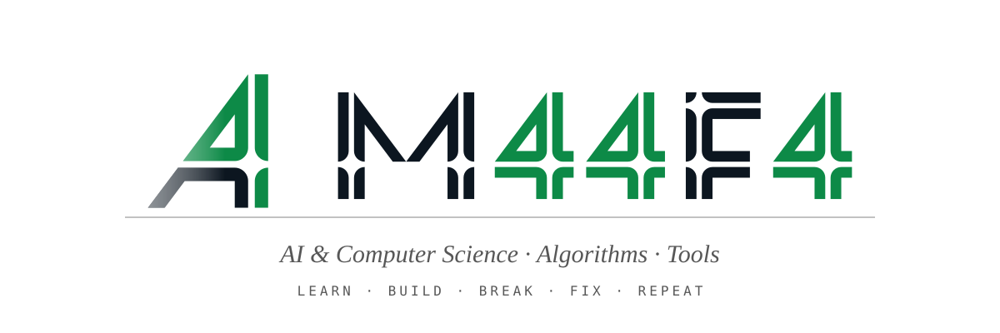

  <picture>
    <source media="(prefers-color-scheme: dark)" srcset="assets/banner-dark.svg">
    
  </picture>

  <a href="https://m44f4.com">
    <picture>
      <source media="(prefers-color-scheme: dark)" srcset="assets/portfolio-dark.svg">
      
    </picture>
  </a>

### Projects

| | |
| :-- | :-- |
| [**cseen**](https://github.com/M44F4/cseen) | Themeable 2D and 3D SVG illustrations and animations for the web. |
| [**Blobble**](https://github.com/M44F4/blobble) | A cozy little companion made from your name. A blob that lives in your tray, bar or desktop, reacts to what you do and keeps you on a Pomodoro. |

### Stack

Languages, ML, web, databases and tools

<h4>Languages</h4>

  
  
  
  
  
  
  
  
  
  
  
  
  
  

<h4>AI / Machine Learning / Data</h4>

  
  
  
  
  
  
  
  
  
  
  
  

<h4>Web / Backend</h4>

  
  
  
  
  
  

<h4>Databases</h4>

  
  
  

<h4>Tools & Systems</h4>

  
  
  

